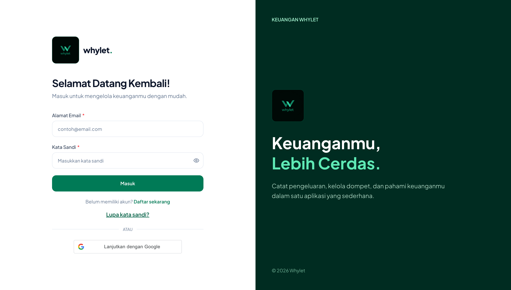
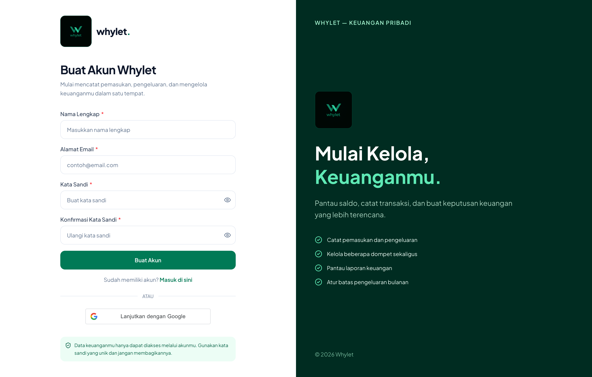
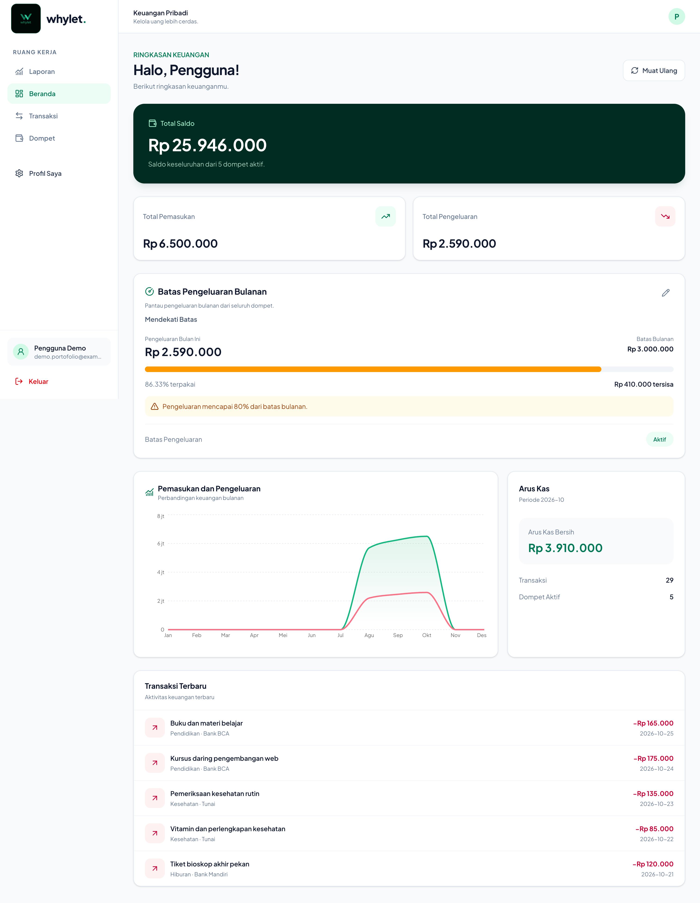
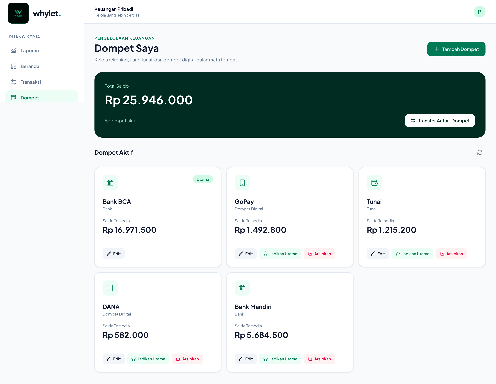
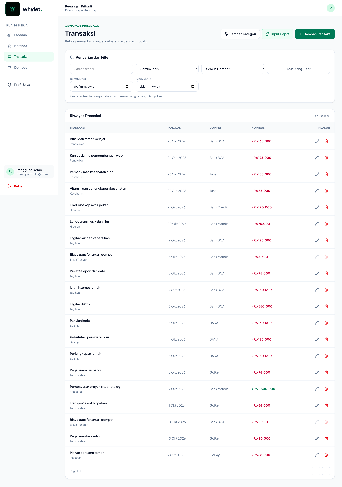
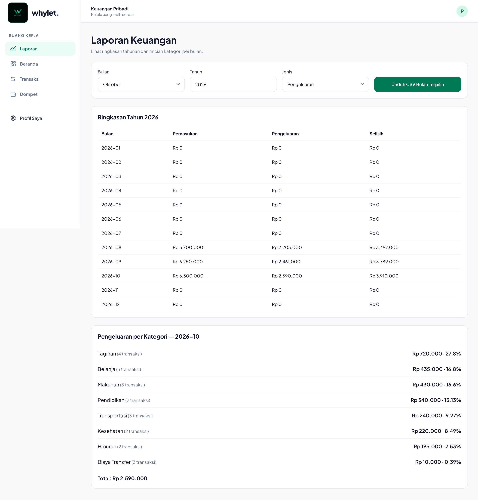

# Whylet

**Kelola uang lebih cerdas.**

Whylet adalah aplikasi web pencatatan keuangan pribadi berbahasa Indonesia untuk membantu pengguna mengelola dompet, mencatat pemasukan dan pengeluaran, melakukan transfer antar-dompet, serta memantau kondisi keuangan melalui dashboard dan laporan yang mudah dipahami.

Dibangun menggunakan **React, Node.js, Express, Prisma, dan MySQL** dengan antarmuka responsif untuk desktop maupun perangkat mobile.

> **Status:** Proyek portofolio / kandidat v1.0. Belum tersedia sebagai layanan publik. Semua nominal dan akun yang ditampilkan pada screenshot merupakan **data demo sintetis**.

## Tampilan Aplikasi

### 1. Login — Masuk ke Whylet

Halaman login menyediakan akses ke akun melalui email dan kata sandi. Terdapat pilihan **Lanjutkan dengan Google**, tautan pendaftaran akun baru, serta fitur **Lupa kata sandi**. Tampilan dua kolom menampilkan formulir autentikasi dan identitas visual Whylet.

### 2. Register — Buat Akun Baru

Halaman registrasi memungkinkan pengguna membuat akun menggunakan nama lengkap, alamat email, kata sandi, dan konfirmasi kata sandi. Validasi formulir membantu memastikan data yang dimasukkan sesuai persyaratan. Pengguna juga dapat memilih opsi pendaftaran dengan Google.

### 3. Beranda — Ringkasan Keuangan

Beranda menyajikan gambaran kondisi keuangan dalam satu layar, mencakup **total saldo seluruh dompet**, total pemasukan dan pengeluaran periode aktif, **batas pengeluaran bulanan** beserta indikator peringatan, grafik pemasukan-pengeluaran, arus kas bersih, serta daftar transaksi terbaru.

Pada contoh data demo, saldo keseluruhan adalah **Rp25.946.000** dari lima dompet aktif. Pengeluaran Oktober mencapai **Rp2.590.000 dari batas Rp3.000.000 (86,33%)**, sehingga aplikasi menampilkan peringatan mendekati batas.

### 4. Dompet — Kelola Banyak Sumber Dana

Halaman Dompet memudahkan pengguna mengelola uang tunai, rekening bank, dan dompet digital dalam satu aplikasi. Pengguna dapat **menambah dan mengedit dompet**, memilih dompet utama, mengarsipkan dompet, serta melakukan **transfer antar-dompet**. Setiap kartu dompet menampilkan saldo tersedia.

Screenshot demo memperlihatkan lima dompet aktif: **Bank BCA, GoPay, Tunai, DANA, dan Bank Mandiri**.

### 5. Transaksi — Catat dan Telusuri Aktivitas

Halaman Transaksi menampilkan riwayat pemasukan dan pengeluaran lengkap dengan **deskripsi, kategori, tanggal, dompet, dan nominal**. Tersedia pencarian serta filter berdasarkan jenis transaksi, dompet, dan tanggal. Pengguna dapat menambah, mengedit, serta menghapus transaksi sesuai aturan aplikasi.

Terdapat juga tombol **Input Cepat** untuk membuat draf transaksi dari kalimat berbahasa Indonesia sebelum dikonfirmasi. Screenshot menampilkan riwayat data sintetis dengan pagination dan nominal pemasukan/pengeluaran yang dibedakan secara visual.

### 6. Laporan — Analisis Keuangan Berdasarkan Periode

Halaman Laporan menyediakan filter **bulan, tahun, dan jenis transaksi**, dilengkapi ringkasan pemasukan, pengeluaran, dan selisih per bulan. Rincian pengeluaran menurut kategori membantu pengguna memahami sumber pengeluaran terbesar. Laporan bulan terpilih dapat **diunduh dalam format CSV**.

Pada data demo Oktober 2026, pemasukan tercatat **Rp6.500.000**, pengeluaran **Rp2.590.000**, dan selisih **Rp3.910.000**. Kategori pengeluaran yang tampil antara lain Tagihan, Belanja, Makanan, Pendidikan, Transportasi, Kesehatan, dan Hiburan.

## Fitur Utama

- **Autentikasi akun:** login/register, integrasi Google, verifikasi email, lupa/reset kata sandi, dan pengaturan profil.
- **Multi-dompet:** pengelolaan rekening, uang tunai, dompet digital, serta dompet utama dan arsip.
- **Pencatatan transaksi:** pemasukan dan pengeluaran dengan kategori, pencarian, serta filter.
- **Transfer antar-dompet:** dukungan biaya administrasi, pencatatan yang konsisten, dan perlindungan terhadap pengiriman transfer ganda.
- **Dashboard keuangan:** ringkasan saldo, aktivitas terbaru, arus kas, dan grafik.
- **Batas pengeluaran bulanan:** indikator penggunaan anggaran serta peringatan ketika mencapai ambang tertentu.
- **Smart Input:** input transaksi dari teks Bahasa Indonesia dan pengenalan suara pada browser yang mendukung, dengan draf yang dapat diedit sebelum disimpan.
- **Laporan & CSV:** ringkasan per periode dan kategori, serta ekspor data.
- **Responsif:** antarmuka yang menyesuaikan layar desktop dan mobile.

## Teknologi

| Bagian | Teknologi |
| --- | --- |
| Frontend | React, Vite, Tailwind CSS |
| Validasi Form | React Hook Form, Zod |
| Grafik | Recharts |
| Backend | Node.js, Express |
| ORM & Database | Prisma ORM, MySQL |
| Autentikasi | JWT, AuthSession, HttpOnly Cookie, CSRF |
| Pengujian | Unit Tests, Playwright, MySQL Integration Tests |
| CI | GitHub Actions |

## Pengembangan & Pengujian

Whylet dikembangkan dengan perhatian pada **isolasi data setiap pengguna**, validasi input, transaksi keuangan yang konsisten, dan pengujian otomatis. Dalam pengujian lokal kandidat v1.0 sebelumnya, **66 kasus pengujian lulus** pada suite browser, MySQL, autentikasi/akun, dan unit. Pengujian unit/build/lint juga dilakukan pada snapshot GitHub, dan workflow GitHub Actions untuk initial commit dilaporkan berhasil.

Beberapa hal masih memerlukan validasi lebih lanjut sebelum digunakan sebagai layanan production, antara lain pengujian layanan eksternal, deployment/HTTPS, pemulihan backup, serta penanganan advisory dependency Prisma 6 yang belum terselesaikan. Karena itu, repository ini **bukan klaim bahwa layanan sudah dideploy atau telah menjalani audit keamanan production menyeluruh**.

## Status Project

**Whylet v1.0 — Proyek portofolio, implementasi lokal selesai.**

Fitur yang dapat dipertimbangkan untuk pengembangan berikutnya meliputi pemindaian struk (OCR), analisis keuangan berbantuan AI, serta peningkatan pengujian dan kesiapan production.

## Penggunaan Kode

Kode sumber ini dipublikasikan untuk tujuan portofolio dan peninjauan. **Tidak ada lisensi penggunaan ulang yang diberikan** untuk repository ini.
